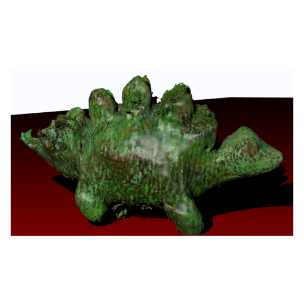

# Freehand Voxel Carving Scanning on a Mobile Device

<p align="center">
  
</p>


An archived iOS application for reconstructing an object by carving a voxel volume from multiple camera views.

Original project credits: Alex Fish, Aaron Wetzler, Y. Honen, Ron Kimmel.

## Available source

This iOS application uses camera views and estimated camera poses to remove voxels that project outside an object's silhouette. It was developed for freehand object scanning on a mobile device. The source includes a capture interface, silhouette processing, voxel carving and mesh display. It also includes a dinosaur example with predefined images, silhouettes and camera matrices.

Alex Fish's original [iPhone-3D-scanner repository](https://github.com/ice00cold/iPhone-3D-scanner) is included as the `source/` Git submodule, pinned to `881f5a8f02d9282d502d4547da0ecb34d5c0f00c`. Its README and code remain unchanged. This is an archival snapshot with no verified current iOS build.

## Setup requirements

The upstream README requires a physical iOS device and excludes simulator use. The Xcode project targets iOS 6.0, links `libpointcloud.a` and uses the PointCloud SDK's camera-pose tracking. Before attempting a build, review the SDK licensing and security notice below and supply your own authorized SDK configuration and signing setup. Compatibility with current Xcode, iOS devices and SDK services has not been tested.

The recursive clone also retrieves the bundled library, executable and historical application key described in the notice below. To inspect the pinned project:

```sh
git clone --recurse-submodules https://github.com/twerdster/freehand-voxel-carving.git
cd freehand-voxel-carving
open source/PointCloudSample/PointCloudSample.xcodeproj
```

These commands retrieve and open the historical project; they do not establish that it builds. The unchanged [upstream README](https://github.com/ice00cold/iPhone-3D-scanner/blob/881f5a8f02d9282d502d4547da0ecb34d5c0f00c/README.md) and tutorial describe the original controls.

## Historical workflow

Initialize camera-pose tracking, position and scale the voxel cube, capture object views, and use the Mesh screen to inspect segmentation and carve from one or all views. The demo mode skips camera capture and uses bundled example data. Ben Tordoff's space-carving example is credited upstream for the dinosaur images, silhouettes and matrices.

The default voxel grid is 128 by 128 by 128 cells, set by `SCULPTURE_SIZE` in [`source/PointCloudSample/PointCloudSample/Sculptor/Sculpture.h`](source/PointCloudSample/PointCloudSample/Sculptor/Sculpture.h). Mesh display is implemented in the app. OBJ and PLY writing hooks in `MeshView.mm` are guarded by `OBJ_TEST` and `PLY_TEST`, both disabled in the pinned file; they are not an enabled export feature of the default project.

## SDK and bundled-material notice

A November 2026 audit found a hardcoded historical PointCloud SDK application key in the pinned source. Its ownership and validity have not been established. Do not reuse it; obtain your own authorized SDK configuration before a build. The snapshot also includes a proprietary static library and a Windows executable. Review vendor terms and bundled material before reuse; their presence is not an endorsement to execute or redistribute them. This wrapper preserves upstream bytes and therefore does not remove the key from that repository or its history.

## Validation and limitations

The submodule pin, Xcode target and selected capture/carving/display paths were inspected. No source or bundled binary was compiled or run during recovery or this documentation revision. No reconstruction accuracy, processing time or device compatibility measurements are available from this review.

## Links

- [Project entry on Aaron Wetzler's website](https://twerdster.github.io/#freehand-voxel-carving-scanning-on-a-mobile-device)
- [Original lab project page](https://gip.cs.technion.ac.il/last-projects-2015-7.html)
- [Original student source](https://github.com/ice00cold/iPhone-3D-scanner)
- [Original tutorial](https://www.youtube.com/watch?v=zy40dpsmprg)

## Attribution and reuse

Retain the upstream PointCloud SDK license files, sample license, branding requirements and third-party attribution. This archive assigns no additional code or media license. Original authors can open an issue to contribute updates or request corrections or removal of their material.

On 2026-11-13 (Israel time), Alex Fish confirmed that he was comfortable with Aaron Wetzler keeping the archival project page and repository, and said he had no additional materials. This records Alex Fish's response only and does not change the upstream or bundled-material terms described above.

Figure provenance: `assets/project-preview.webp` is the thumbnail used on Aaron Wetzler's website, a crop of the project figure on the [original lab project page](https://gip.cs.technion.ac.il/last-projects-2015-7.html). The thumbnail is copied without further modification to identify the original student work. It is a historical project figure, not a result produced during recovery; the archive does not identify whether it came from live capture or the bundled example.

