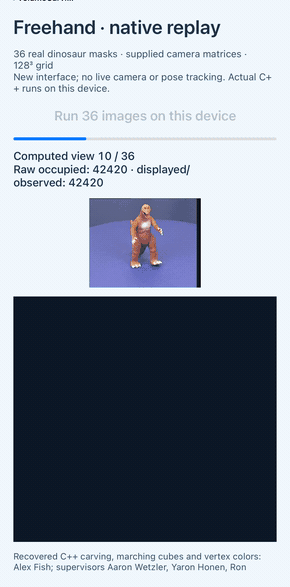
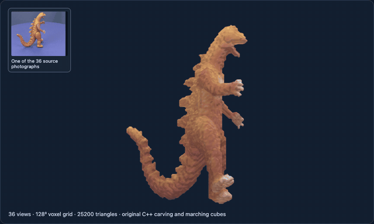

# Offline Freehand Voxel Carving replay

## Updated and ported for modern hardware

The recovered C++ carving, marching-cubes and color routines now build on macOS and Linux through updated dependency interfaces, with fixes to occupancy initialization and depth-buffer dimensions and access. New iOS, Android and desktop interfaces replay the supplied 36-view dinosaur fixture using known camera matrices; live capture and the historical tracking SDK are not restored.

| iPhone 12 · native execution | Offline colored-mesh rendering · macOS |
| --- | --- |
|  |  |

The phone runs the new frontend on supplied images and camera matrices; it does
not capture or estimate poses. Recordings: [iOS](assets/ios-native.mp4) ·
[Android](assets/android-native.mp4) · [macOS](assets/macos-native.mp4) ·
[Linux](assets/linux-native.mp4).


This update runs the recovered C++ voxel carving, marching cubes and color
accumulation on macOS and Linux. The animation renders a mesh reconstructed from
the bundled 36 dinosaur photographs, masks and camera matrices on the Mac. It is
a new offline replay result. [PNG](assets/dinosaur-reconstruction.png) ·
[MP4](assets/dinosaur-turntable.mp4).

## New native interfaces

The new [iOS, Android, macOS and Linux interfaces](PLATFORMS.md) execute the
recovered C++ reconstruction on the supplied 36-view fixture, then render its
computed geometry. They use known camera matrices and do not restore live camera
capture or the historical SDK. [Build/runtime/capture records](validation/native-platforms/)
keep executable results separate from recordings and declared platform support.

## Build and use

Requirements: a C++14 compiler, CMake 3.20+, Python 3, pkg-config, OpenCV
core/imgproc development files and libpng development files. From the repository
root, with those dependencies available:

```sh
git submodule update --init source
cmake -S updated -B build/freehand -DCMAKE_BUILD_TYPE=RelWithDebInfo
cmake --build build/freehand -j4
ctest --test-dir build/freehand --output-on-failure
mkdir -p output/freehand
./build/freehand/freehand_offline --demo source/PointCloudSample/dinosaur output/freehand --historical-matrices
python3 updated/tools/render_demo.py output/freehand output/freehand/viewer.html
```

Open the generated `viewer.html` in a WebGL-capable browser to rotate the colored
mesh. It embeds the mesh data. Outputs include colored `dinosaur.ply`, geometry
`dinosaur.obj`, input/reprojected silhouette PNGs and `metrics.json`.

The original source remains pinned and unchanged. `updated/prepare_sources.py`
creates adapted build-tree copies: it replaces removed container/platform
includes, initializes occupancy borders and corrects the depth buffer's
height/width and scalar accesses. Reconstruction still uses the recovered
carving, `Polygonise` and color routines. The offline driver supplies correctly
typed matrices and PNG IO; it does not initialize or link the PointCloud SDK.

See [build and implementation details](BUILD.md) for a no-sudo Ubuntu 22.04
dependency setup, calibration conventions, sanitizer commands and the patch manifest.
The illustrated command uses the original application's rounded `demoP` table
verbatim. The default text-file matrix importer handles a packing change within
the bundled files; its separately recorded result is described in that guide.

## What was checked

Four component checks passed on Mac and Linux: deterministic occupancy borders,
portrait-image depth buffering/occlusion, two-vote carving of an analytic prism,
and marching-cubes empty/single-corner cases. Under Linux ASan/UBSan, the four
checks and full 36-view historical-matrix replay completed without reported errors.
Controls retaining the original defects fail the boundary assertion and reproduce
a depth-buffer heap overflow under Linux ASan. OpenCV itself was not rebuilt with
sanitizers. The Mac sanitizer attempt failed during Homebrew TBB shutdown and is
not counted as clean.

The historical-matrix replay on both platforms produced **22,377 occupied voxels,
25,200 triangles and 10,654 distinct RGB colors**. A separately written reference
applying the same two-vote rule matched occupancy throughout the 128³ grid.
Vertices were finite and within grid bounds; array lengths matched the triangle
count, with no zero-area triangles. In this earlier `freehand_offline` comparison, exported geometry/faces matched
across platforms and five vertex colors differed by one level out of 255. In the
later native C-ABI desktop comparison, normalized positions matched and 10 RGBA
channel bytes differed by 1/255 ([record](validation/native-platforms/desktop-cross-platform.json)). [Validation and logs](VALIDATION.json) ·
per-view measurements: [Mac](validation/mac-historical-metrics.json) /
[Linux](validation/linux-historical-metrics.json).

Mean/minimum silhouette IoU over the **36 input views** was **0.9520/0.9380**.
This measures consistency with the supplied masks, not held-out or independent
3D accuracy. A visual hull cannot recover unconstrained concavities; recovered
color visibility/fallback logic can produce patchy coloring. No speed benchmark,
new camera-pose estimation or live SDK validation is claimed. The original
armv7/iOS 6 application remains unsupported by the tested Xcode 16.1 toolchain.

Original project: Alex Fish, supervised by Aaron Wetzler, Yaron Honen and Ron
Kimmel. Dinosaur data: [VGG multiview sequence](https://www.robots.ox.ac.uk/~vgg/data/mview/),
credited to Wolfgang Niem, Hannover, and bundled through Ben Tordoff's example.
Existing source/sample/SDK notices remain; no new blanket source or dataset
license is assigned, and no additional license grant is made for the new
maintenance files.
